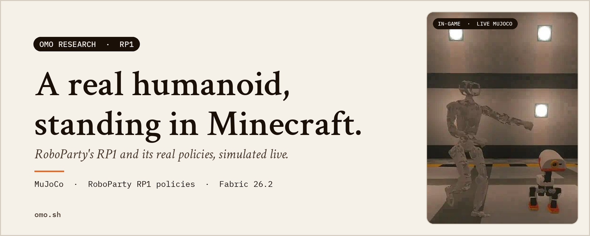
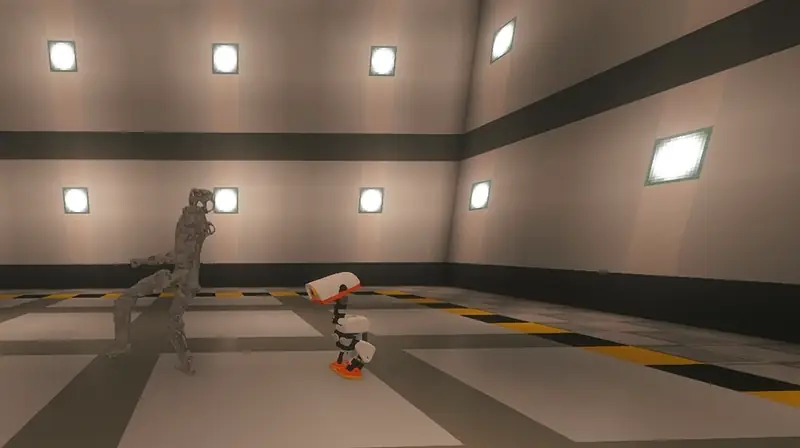
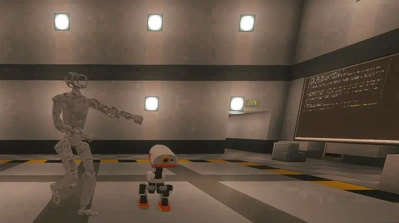
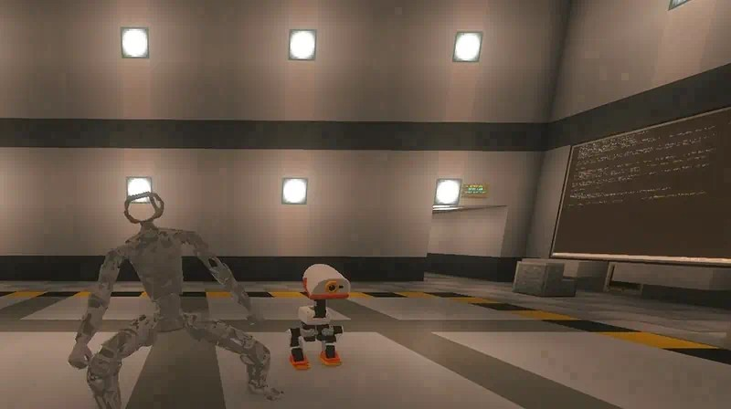
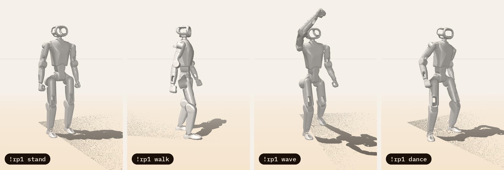
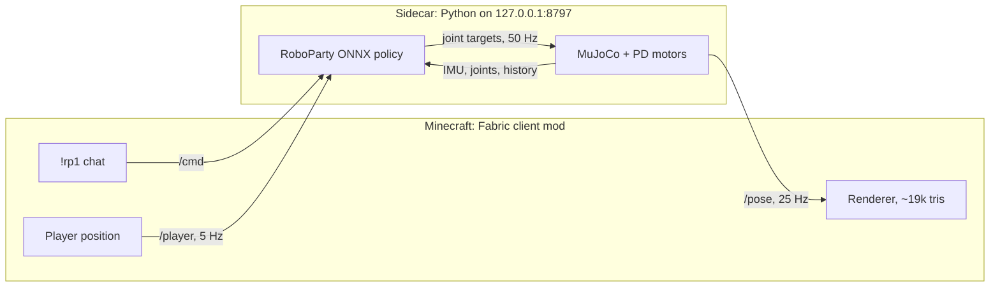
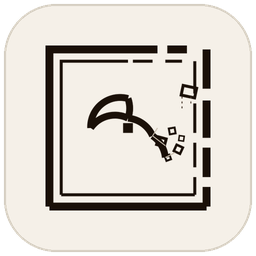

<picture>
  <source media="(prefers-color-scheme: dark)" srcset="docs/media/hero-dark.png">
  
</picture>

<h1 align="center">Omo RP1</h1>

<p align="center">
  Not a mob. Not an animation. RoboParty's open-source <b>RP1 humanoid</b>,<br>
  its real model and its real RL policies, simulated live in MuJoCo and standing in your world.
</p>

<p align="center">
  <a href="https://github.com/omoresearch/omo-rp1"><picture><source media="(prefers-color-scheme: dark)" srcset="docs/media/btn-star-dark.png"></picture></a>&nbsp;
  <a href="#quick-start"><picture><source media="(prefers-color-scheme: dark)" srcset="docs/media/btn-quickstart-dark.png"></picture></a>&nbsp;
  <a href="#straight-from-the-stream"><picture><source media="(prefers-color-scheme: dark)" srcset="docs/media/btn-reels-dark.png"></picture></a>
</p>

<p align="center">
  <sub>⭐ <b>Star the repo to follow the robots.</b> &nbsp;·&nbsp; <a href="#how-it-works">How it works</a> &nbsp;·&nbsp; <a href="sidecar/CONTRACT.md">API</a> &nbsp;·&nbsp; <a href="https://github.com/omoresearch/omo-microduck">Omo Microduck</a> &nbsp;·&nbsp; <a href="https://www.omo.sh">omo.sh</a></sub>
</p>

<p align="center">
  
  
  
  
  
</p>

<br>

## Straight from the stream

<p align="center">
  <a href="https://www.instagram.com/reel/DfA07BVAaez/"></a>
</p>

<p align="center">
  <a href="https://www.instagram.com/reel/DfA07BVAaez/"><b>▶ Watch the RP1 reel on Instagram</b></a> (with sound) &nbsp;·&nbsp; live on <a href="https://www.twitch.tv/yiifannn">Twitch</a>
</p>

<sub>An in-game loop from the robot lab in our Omo Space world: the RP1 on the left, the
<a href="https://github.com/omoresearch/omo-microduck">Microduck</a> on the right. Nothing is keyframed:
every pose of the RP1 is RoboParty's policy driving live MuJoCo physics, drawn by this mod.</sub>

## In the game

<table>
<tr>
<td width="50%"></td>
<td width="50%"></td>
</tr>
<tr>
<td align="center"><sub><b>About human size.</b> At scale 1, one sim metre is one block, so the RP1 stands ~1.5 blocks tall.</sub></td>
<td align="center"><sub><b>Every joint is physics.</b> 24 motors, 25 bodies, posed 25 times a second from the sim.</sub></td>
</tr>
</table>

## Why this exists

Most game companions are puppets: hand-made animations that play when a script
says so. The RP1 in this mod is the opposite. Every step it takes is a neural
network pushing simulated motors against simulated gravity. If it falls, it
really fell. When it waves, a motion-tracking policy is balancing a 24-joint
body on two feet while it does it.

It is RoboParty's open-source humanoid, with the policies RoboParty trained for
the real robot. Now it stands in your world, follows you around your base, and
answers when you talk to it.

At [Omo Research](https://www.omo.sh) we build agents that are **present**:
they have a body, a place and a voice. Omo RP1 is that idea at human scale.

## What it does

| Feature | What you get |
|---|---|
| **Real robot, real physics** | RoboParty's RP1 24-DoF MJCF and CAD meshes, MuJoCo at 500 Hz physics / 50 Hz policy, PD gains and motor limits from RoboParty's own training config, on one CPU core (~8% while standing or walking). |
| **Real brains** | RoboParty's pretrained ONNX policies: `policy.onnx` walks, turns and stands, `policy_wave.onnx` tracks a recorded wave, `policy_ufo.onnx` plays a dance latent. No animation files anywhere. |
| **Walk, turn, follow, wave, dance** | It walks at ~0.4 m/s with a heading hold, turns 90° on command, follows you and stops about a metre away, waves, and dances for 30 s. |
| **Stays home** | A leash (6 m by default) keeps it near its anchor: it turns back on its own, and walks home if a dance drifts too far. |
| **Real falls** | Shove it and it falls for real. There is no get-up policy for the RP1, so after 3 s on the floor it respawns upright at the anchor. |
| **Looks the part** | 25 bodies, ~19k triangles decimated from the CAD on your machine, smooth normals and baked ambient occlusion. Lit like a mob; works with Sodium and Iris shader packs. |
| **Chat-controlled** | `!rp1 walk`, `!rp1 follow`, `!rp1 wave`, `!rp1 dance`. Commands are handled client-side and never sent to the server. |
| **Stream-safe API** | Anything on your machine can drive it over loopback HTTP. Commands tagged `"from":"twitch:<user>"` can walk, wave and dance it; they cannot reset it. |
| **Talks back** *(optional)* | With Simple Voice Chat, hold push-to-talk near the RP1 and its reply plays from its head, in positional audio, with captions and a small talking gesture. Needs your own voice backend. |

### The same brains, without Minecraft

<p align="center">
  
  <br><sub>Offscreen MuJoCo renders from the sidecar's own sim (<a href="docs/media/make_renders.py"><code>docs/media/make_renders.py</code></a>): stand, walk, wave, dance.</sub>
</p>

## Quick start

You need **Minecraft Java 26.2** with **Fabric Loader** and **Fabric API**,
plus Python 3.12+, `git` and a **JDK 21+** (there is no release jar yet, so you
build the mod). Tested on Linux x86_64. macOS should work but has not been
tested yet. If you have [`uv`](https://github.com/astral-sh/uv), setup uses it.

**1. Start the brain (the sidecar)**

```bash
git clone https://github.com/omoresearch/omo-rp1 ~/omo-rp1
cd ~/omo-rp1/sidecar && ./setup.sh
OMP_NUM_THREADS=1 nice -n 10 .venv/bin/python server.py
```

`setup.sh` creates a virtualenv, downloads RoboParty's RP1 model, policies and
configs onto your machine at pinned commits (about 81 MB, straight from
RoboParty's GitHub; none of it is redistributed here), and runs a 2-second smoke
test. The first start then builds the in-game mesh (about 40 s, cached). To keep
it running, there is a user service in
[`sidecar/contrib/`](sidecar/contrib/rp1-sim.service).

**2. Build and install the mod**

```bash
cd ~/omo-rp1/mod
python3 deps/fetch.py      # optional: Simple Voice Chat API for the voice plugin (hash-checked)
MC_LIBRARIES=/path/to/launcher/libraries MC_MODS=/path/to/instance/mods ./build.sh install
```

`MC_LIBRARIES` is your launcher's libraries folder (Prism: `<prism data>/libraries`, or set `PRISM=<prism data>`),
and `MC_MODS` your instance's `mods/` folder (it must already hold `fabric-api-*.jar`). Restart the game.
Optional: add [Simple Voice Chat](https://modrinth.com/plugin/simple-voice-chat) for voice.

**3. Meet your robot**

Stand on a flat floor where you want it and type in chat:

```
!rp1 here       put the RP1 at your feet (saved)
!rp1 walk       off it goes
!rp1 follow     it comes after you, inside its leash
!rp1 wave       hello
!rp1 dance      30 seconds of RoboParty's dance policy
!rp1 stop       stand still
```

<details>
<summary><b>Every chat command</b></summary>

| Command | Effect |
|---|---|
| `!rp1` / `!rp1 help` | help |
| `!rp1 walk` / `stop` / `follow` / `wave` / `dance` / `reset` | moves (`reset` respawns it upright at the anchor) |
| `!rp1 left` / `right` | turn 90° |
| `!rp1 here` | anchor the sim at your feet (saved) |
| `!rp1 scale <0.25-10>` | blocks per sim metre (default 1: the RP1 is about 1.5 blocks tall) |

Replies show as `[RP1] ...` in chat. Settings live in `config/rp1.properties`.
</details>

## How it works



- **Sidecar** (`sidecar/`): one Python process steps the RP1 at a fixed 50 Hz in
  MuJoCo. It builds the same observation RoboParty's deploy code builds (angular
  velocity, projected gravity, command, joint positions and velocities, last
  action, with 3-frame history), runs the ONNX policy, low-pass filters the
  action like the real robot's controller, and drives the joints with PD torques
  using the gains the policies were trained with. On top sit a heading hold, a
  leash, follow-the-player, fall detection and auto-reset. Pose snapshots go out
  over loopback HTTP.
- **Mod** (`mod/`): a Fabric client mod. It fetches the mesh once, polls poses at
  25 Hz on a background thread, and draws each body part interpolated every
  frame, so a network hiccup never stalls the game. It maps MuJoCo's z-up metres
  to Minecraft blocks and handles chat and voice.
- **Contract**: the full HTTP API is in [`sidecar/CONTRACT.md`](sidecar/CONTRACT.md).
  Anything that speaks it can drive the robot. The deep dive (observation layout,
  gains, measured speeds) is in [`sidecar/README.md`](sidecar/README.md).

Cost on our streaming PC: about **8% of one core** standing or walking and 15%
while dancing, 0.7 ms of the 20 ms step budget for the walking policy, and about
160 MB of RAM for the sidecar.

## Verified

Re-run against this exact tree (Linux x86_64, upstream pinned at RoboParty commits
`d8c6dd0` / `7a11782` / `9ccf7f2`):

| Suite | Result |
|---|---|
| `sidecar/test_headless.py`: stand, talk gesture, walk, stop, turn, follow, leash, reset, falls, wave, dance, step budget, model | **14/19 pass so far** (stand, talk, walk, stop, turn, follow, leash, reset, wave); dance and the last checks run after the stream |
| `mod/build.sh`: plain `javac` build of the mod, voice plugin included | **builds** (50.7 kB jar) |
| `mod/build.sh test`: mod harness against `mod/test/fake_sidecar.py` (parsing, mapping, model bake, network, sidecar-down) | **70/70 pass** |
| `mod/build.sh voicetest`: PCM framing, config, head position, focus arbitration, real Opus round trip | **28/28 pass** |
| `mod/test/check_refs.py`: every Minecraft / Fabric / SVC member the mod calls exists in the 26.2 jars | **132/132 found** |

`sidecar/fetch_upstream.py` at the pinned commits reproduces, byte for byte, the
upstream files the measurements in [`sidecar/README.md`](sidecar/README.md) were made with.

## Build from source

```bash
cd mod
python3 deps/fetch.py          # optional: Simple Voice Chat API (hash-checked)
MC_LIBRARIES=/path/to/launcher/libraries MC_MODS=/path/to/instance/mods ./build.sh
./build.sh test http://127.0.0.1:8799   # harness against python3 test/fake_sidecar.py 8799
```

The mod builds with plain `javac`, because Minecraft 26.2 ships unobfuscated.
No Gradle is needed. See [`mod/README.md`](mod/README.md) and
[`sidecar/README.md`](sidecar/README.md) for the rendering pipeline, the voice
protocol, the observation layout and the known sim-to-real gaps.

## Honest limitations

- **No release jar yet.** You build the mod yourself (step 2 above).
- In this CPU sim, `policy.onnx` reaches about 0.8× its commanded speed and steps
  in place below ~0.25 m/s, so the sidecar scales commands up by 1.25. Speeds are
  "nominal", not exact; top speed is about 0.48 m/s.
- The robot only knows a **flat floor**. It cannot see Minecraft blocks: it walks
  through walls and does not climb stairs. Anchor it on flat ground.
- There is **no get-up policy** for the RP1. Every fall ends in a respawn at the anchor.
- The voice backend (our "Roboto" persona) is **not in this repo**. The mod's voice
  plugin and its WebSocket protocol are, so you can bring your own.
- Singleplayer and client-side only. Other players do not see your robot.
- RoboParty's model files carry no licence upstream, so they are fetched from
  RoboParty on your machine rather than shipped here. If upstream moves or
  disappears, setup breaks until the pins are updated.

## Credits

The RP1 robot, its model and its policies are by
**[RoboParty](https://github.com/Roboparty)**: the model from
[RP1_description](https://github.com/Roboparty/RP1_description) (no licence stated upstream; fetched on your
machine, not redistributed), the policies and deploy pipeline from
[roboparty_inference](https://github.com/Roboparty/roboparty_inference) (GPL-3.0), the training config from
[robolab](https://github.com/Roboparty/robolab) (BSD-3-Clause). Full list in
[THIRD_PARTY_NOTICES.md](THIRD_PARTY_NOTICES.md). Built by **[Omo Research](https://www.omo.sh)**.
The mod is [MIT](LICENSE); the sidecar is [GPL-3.0-only](sidecar/LICENSE).

**NOT AN OFFICIAL MINECRAFT PRODUCT. NOT APPROVED BY OR ASSOCIATED WITH MOJANG OR
MICROSOFT.** Independent community project, not affiliated with or endorsed by RoboParty.

<br>

<p align="center">
  <a href="https://github.com/omoresearch/omo-rp1"><picture><source media="(prefers-color-scheme: dark)" srcset="docs/media/btn-star-dark.png"></picture></a>
</p>
<p align="center">
  <a href="https://github.com/omoresearch/omo-rp1/stargazers"></a>
  <br><sub>⭐ Star the repo to follow the robots.</sub>
</p>

<br>

<p align="center">
  <a href="https://www.omo.sh"></a>
  <br><sub><i>The next interface isn't a chat window.</i> · Omo Research · <a href="https://www.omo.sh">omo.sh</a></sub>
</p>
